

# ComfyUI Workflows
**My personal Workflows.**

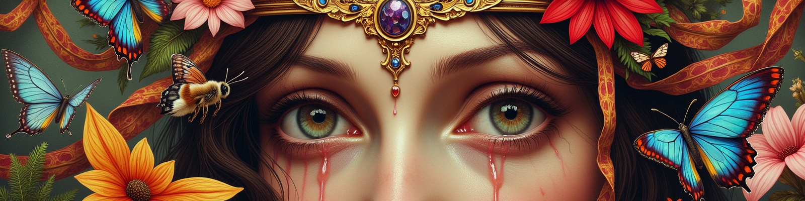

This is simply a repository I decided to create to keep a copy of my ComfyUI Workflows, which I've been using for years. Furthermore, since I've learned so much from the community on Discord and Reddit, I'm happy to share it with everyone.

Feel free to use them and make your own customizations. Note that I am using, in some cases, GGUF models on my computer (RTX3060 12GB and 16GB of RAM); change its nodes if you are using native models.

If you find something that could be improved and you'd like to share it with me, let me know here or through my Reddit by the username VictorDmAlves.

If you like to keep track of any changes that I make to the Workflows, be sure to Watch this repository on GitHub.

## Latest release
### 1.6
Added
- Workflows for MOSS Image Edit.

Update
- I wasn't satisfied with the way the images were being saved, so I changed those parameters across all Workflows.
- Overhaul update of README.

## Dependencies
I highly recommend using Straight lines in the `Lite Graph` settings, under the `Graph` section. Either this, or keep the lines invisible. My Workflows were built with this in mind.

I don’t like using Subgraph, and even less so Nodes 2.0; you won’t be seeing them around here!

To use this Workflows, install the following `custom_nodes` in your ComfyUI (you probably already have some of them):
- [ComfyUI Manager](https://github.com/Comfy-Org/ComfyUI-Manager).
- [Comfy-KepListStuff](https://github.com/M1kep/Comfy_KepListStuff).
- [ComfyUI's ControlNet Auxiliary Preprocessors](https://github.com/Fannovel16/comfyui_controlnet_aux).
- [ComfyUI Essentials](https://github.com/cubiq/ComfyUI_essentials).
- [ComfyUI-Detail-Daemon](https://github.com/Jonseed/ComfyUI-Detail-Daemon).
- [Florence2 in ComfyUI](https://github.com/kijai/ComfyUI-Florence2).
- [ComfyUI-GGUF](https://github.com/molbal/ComfyUI-GGUF).
- [ComfyUI-Impact-Pack](https://github.com/ltdrdata/ComfyUI-Impact-Pack).
- [ComfyUI-Impact-Subpack](https://github.com/ltdrdata/ComfyUI-Impact-Subpack).
- [ComfyUI-Inspire-Pack](https://github.com/ltdrdata/ComfyUI-Inspire-Pack).
- [KJNodes for ComfyUI](https://github.com/kijai/ComfyUI-KJNodes).
- [QwenVL for ComfyUI](https://github.com/1038lab/ComfyUI-QwenVL).
- [ComfyUI-SeedVR2_VideoUpscaler](https://github.com/numz/ComfyUI-SeedVR2_VideoUpscaler).
- [ComfyUI Simple Prompt Batcher](https://github.com/ai-joe-git/ComfyUI-Simple-Prompt-Batcher).
- [ComfyUI-VideoHelperSuite](https://github.com/Kosinkadink/ComfyUI-VideoHelperSuite).
- [rgthree-comfy](https://github.com/rgthree/rgthree-comfy).
- [WAS Node Suite (Revised)](https://github.com/ltdrdata/was-node-suite-comfyui).
- [Z-Image Power Nodes](https://github.com/martin-rizzo/ComfyUI-ZImagePowerNodes).
- [ComfyUI WD 1.4 Tagger](https://github.com/pythongosssss/ComfyUI-WD14-Tagger).
- [ComfyUI_UltimateSDUpscale](https://github.com/ssitu/ComfyUI_UltimateSDUpscale).
- [ComfyUI Layer Style](https://github.com/chflame163/ComfyUI_LayerStyle).

## Optional
I’ve put together a pack containing all the `custom_nodes` I use for my Workflows with a `+` on their names. If you're interested, use this pack in conjunction with my Workflows. I also provide individual versions of this nodes, in case you aren't interested in all of them:
- [ComfyUI VicNodes](https://github.com/VictorDmAlves/comfyui-vicnodes).

For my Krea TXT2IMG+ Workflow, is required to have the following `custom_node`:
- [RES4LYF](https://github.com/ClownsharkBatwing/RES4LYF).

## Tips and Tricks
- Change Models: In all my Workflows, you will see that is included a SeedVR2 Workflow for all models. In addition to the features it provides, it can be used to transform an image into another image using a different model thanks to the second KSampler. For instance, you can take an image created in Z-Image-Turbo and place it directly into Flux's SeedVR2. Not only will it transform the image into a Flux image, but it will also allow you to maintain the similarity between the models as much as possible.
- Swap Characters: For Flux2 Klein, let's say that you want to swap characters between X (real life photo) with Y (art style photo). It's better to replace the background of X to a white color, then change his style to be exactly the same art style of Y to finaly ask Klein to, with this two changes done, swap X with Y, keeping the same pose if you like. Thanks to [arthan1011](https://www.reddit.com/r/comfyui/comments/1qs2h6p/replace_this_character_workflow_with_flux2_klein/) for this find.
- Upscale technique for Flux and Flux2: For both of this models, has a technique to upscale a image using tiles together with SeedVR2. Because it divides the image into tiles, performing individual upscaling, when everything is combined into a single image, the result is truly impressive. Thanks to [Wei Mao](https://www.youtube.com/watch?v=QHn6Qg59e8Y) for this find.
- Two LoRA in one image: Recently I discovered Illustrious model and fell in love with the SDXL again (I believe Anima helped me with that). That said, I was curious to know if there was a way to place two LoRAs of different characters in a single image, using only one KSampler, without creating artifacts or duplicates. Here's the Workflow with Hooks, a technique that consists of rendering each LoRA in a piece of the image using masks, combining them afterwards. Thanks to [Nikhil Setiya](https://www.youtube.com/watch?v=zhJJcegZ0MQ) for this find.
- I've created a simple and lightweight [browser-based tool](https://github.com/VictorDmAlves/caption-editor/) designed to make image captioning faster and more convenient. I've been using for LoRA training, I hope it's useful for you too.

Folder with examples of this [Tips and Tricks](./Images/EXAMPLES/).

## Z-Image-Turbo
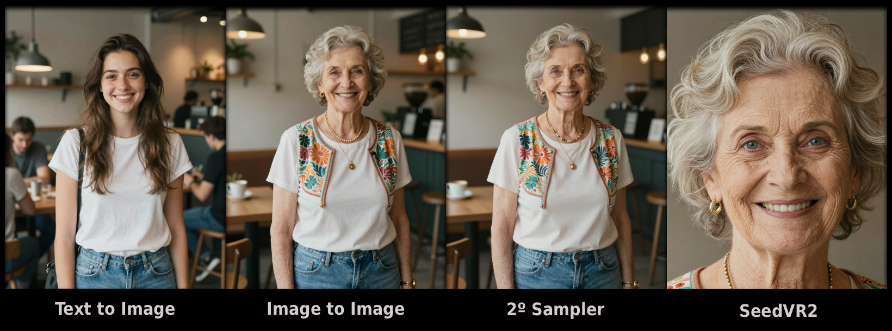

My favorite model! Not only for its speed and image quality, but also for its consistency and prompt adherence. It's incredibly versatile. Although Z-Image Base is recommended for training, I don't plan to create a separate Workflow for it, as the Turbo version is already more than capable for my needs. I've also been loving creating LoRAs for this model, and I hope to share some of them with you all someday!

### Wildcards & Custom Nodes
I've started using Wildcards to generate more dynamic and unique images. For now, I'm using entire prompts rather than individual keywords, switching between them to maintain a bit more control over the results. I'm also sharing some of the [Wildcards](./Wildcards/) I use with this model.

I've included an additional Workflow (TXT2IMG+) that integrates two of my own `custom_nodes`. They provide better control over Wildcard prompts and allow for persistent image viewing. You can find more details in the [Optional](#Optional).

I've also created two Spatial Workflows using another of my `custom_nodes`, which allows you to apply up to three different LoRAs to specific regions of an image, all within a single node. It gives you more control over where each LoRA is applied while helping maintain the integrity of the final image. My goal is to eventually bring this concept to all the models I use.

### Available Workflows
Here are the Workflows I've created so far:
| Workflow | Description |
|---|---|
| TXT2IMG | A simple Text-to-Image Workflow using a `custom_node` with style presets and Wildcard support. |
| TXT2IMG+ | An extended version of TXT2IMG, integrating two of my `custom_nodes` for better Wildcard control and persistent image viewing. |
| IMG2IMG | An Image-to-Image Workflow with ControlNet integration, useful when you want to generate an image that closely resembles the original. |
| Spatial TXT2IMG | A Text-to-Image Workflow using my Spatial LoRA `custom_node` to apply up to three different LoRAs to specific regions of an image. |
| Spatial IMG2IMG | Similar to Spatial TXT2IMG, but designed for Image-to-Image generation, allowing you to work with an existing image while controlling where each LoRA is applied. |
| Inpaint | Designed to be as simple as possible. Just load an image, choose whether to create the mask manually or let Florence2 handle it, and start inpainting! |
| SeedVR2 Upscaler | Runs the image through a second KSampler to add more details. After that, you can enable the SeedVR2 group for further upscaling. |
| Tile & SeedVR2 Upscaler | An impressive way to enhance images by dividing them into tiles, upscaling each one individually, and then combining them into a single, higher-quality image. |
| XY Plot | Created to compare different settings, such as a range of LoRA strength values. You can easily adapt it to test and visualize other parameters as well. |

Folder to the Workflows [Z-Image](./Workflows/Z-IMAGE/).
Folder with example [Images](./Images/Z-IMAGE/).

## MOSS
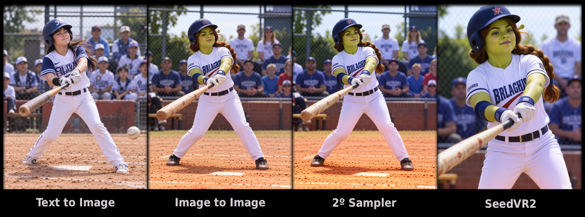

MOSS-Image is a new 5B text-to-image generation model developed by the OpenMOSS team. It stands out for its impressive ability to render text directly into images, advanced layout control, and support for long, detailed prompts.

One of its most interesting features is the ability to interpret JSON-based layouts containing bounding boxes (BBoxes), allowing for more precise control over image composition. It's somewhat similar to what Ideogram 4.0 offers, although both models produce quite different results.

I've been really enjoying this model! It's incredibly impressive and versatile, especially considering it has only 5B parameters. I'm still exploring its capabilities, but so far, the results have been fantastic.

For those looking for faster generation, I recommend using the official 8-step LoRA, at least until an official Turbo version becomes available (I’m using one that I found; find the link within the Workflow).

### Custom Nodes
I've also created some of my own `custom_nodes` to improve and optimize MOSS-Image's results. Some of the Workflows below integrate these nodes, offering more complete sampling options and additional features for image generation and editing.

If you're interested, you can find more details in the [Optional](#Optional) section.

### Available Workflows
Here are the Workflows I've created so far:
| Workflow | Description |
|---|---|
| TXT2IMG | A simple Text-to-Image Workflow using the SFT version of MOSS-Image. |
| TXT2IMG+ | An extended version of TXT2IMG, integrating my `custom_nodes` for more complete sampling options and better control over generation. |
| Turbo TXT2IMG | Similar to TXT2IMG, but using the unofficial 8-step LoRA for faster image generation. |
| Turbo TXT2IMG+ | The same as Turbo TXT2IMG, but integrating my `custom_nodes` for more complete sampling options. |
| IMG2IMG | An Image-to-Image Workflow using the SFT version, allowing you to generate new images based on an existing one. |
| IMG2IMG+ | An extended version of IMG2IMG, using my `custom_nodes` for more complete sampling options and better control. |
| Turbo IMG2IMG | The same as IMG2IMG, but using the unofficial 8-step LoRA for faster generation. |
| Turbo IMG2IMG+ | The same as Turbo IMG2IMG, but integrating my `custom_nodes` for more complete sampling options. |
| SeedVR2 Upscaler | Uses a second KSampler to enhance details before optionally upscaling the image through the SeedVR2 group. Uses the SFT version. |
| Turbo SeedVR2 Upscaler | The same upscaling process, but using the unofficial 8-step LoRA. |
| Tile & SeedVR2 Upscaler | An impressive way to enhance images by dividing them into tiles, upscaling each one individually, and then combining them into a single, higher-quality image. Uses the SFT version. |
| Turbo Tile & SeedVR2 Upscaler | The same tile-based upscaling process, but using the unofficial 8-step LoRA. |
| Edit | Uses a dedicated LoRA to enable context-aware image editing, allowing you to modify an existing image or use a second image as a reference for more specific adjustments. |
| Edit+ | An extended version of Edit, integrating two of my `custom_nodes`: one for more complete sampling options and another for loading and managing multiple reference images within a single node. |

Folder to the Workflows [MOSS](./Workflows/MOSS/).
Folder with example [Images](./Images/MOSS/).

## Wan 2.2

  
🎬 Example Video

  
  

  <video src="https://github.com/user-attachments/assets/a0dbcc65-0d17-4919-87fd-a60485ef7bca" width="70%" poster=""> </video>
  

Honestly, this model is extremely impressive! I'm genuinely surprised by its flexibility and realism, especially considering it's primarily designed for video generation. Combined with the huge collection of LoRAs available for it, WAN has proven to be a very capable and versatile model for both image and video generation.

I've been enjoying experimenting with its different capabilities, especially how well it handles image generation despite being a video-focused model. There's still plenty for me to explore, particularly with VACE and its more advanced features.

### Available Workflows
Here are the Workflows I've created so far:
| Workflow | Description |
|---|---|
| TXT2IMG | A simple Text-to-Image Workflow using WanVideoNAG for better control over image generation. |
| IMG2IMG | An Image-to-Image Workflow without ControlNet integration for now. WAN has its own approach through VACE, which is a different beast entirely, and I'm still experimenting with it! |
| TXT & IMG2VID | Uses the 5B model for both Text-to-Video and Image-to-Video generation, producing videos with good quality and duration. I've also included an option to stitch two videos together, making them appear as a single, continuous sequence. |
| SeedVR2 Upscaler | Uses a second KSampler to enhance details before optionally upscaling the image through the SeedVR2 group. |
| Tile & SeedVR2 Upscaler | An impressive way to enhance images by dividing them into tiles, upscaling each one individually, and then combining them into a single, higher-quality image. |

Folder to the Workflows [Wan](./Workflows/WAN/).
Folder with example [Images and Video](./Images/WAN/).

## Qwen2.1
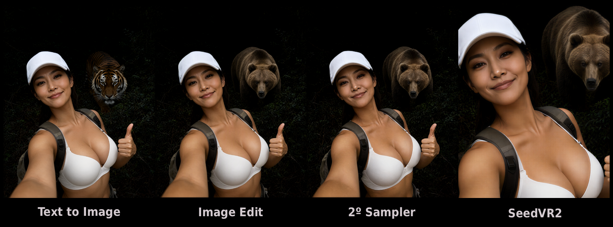

Qwen-Image 2.1 is a text-to-image generation model developed by the Qwen team, bringing significant improvements in image quality, prompt understanding, text rendering, and high-resolution image generation.

Beyond text-to-image generation, it also offers powerful image editing capabilities, allowing you to modify existing images through natural language instructions. With support for multiple reference images, you can change clothing, objects, environments, artistic styles, and other visual elements while maintaining better control over the original composition and subject identity.

One of its most interesting features is the ability to generate images at native 2K resolution, producing impressive levels of detail without necessarily requiring additional upscaling or a second sampling pass.

I've been particularly impressed by its photorealistic results, especially at higher resolutions. The Turbo version is also surprisingly capable, delivering excellent image quality in just 8 steps!

For the Turbo model, I strongly recommend using its dedicated sigma schedule instead of a conventional scheduler. From my own tests, I've noticed a significant improvement in image quality with this approach.

### Custom Nodes
I've also included additional Workflows that integrate two of my own `custom_nodes`, making the generation and editing process more practical and flexible.

One of them is my Hybrid Sampler, which combines sampling options into a single, more compact node, helping reduce clutter in the Workflow. The other is my Load Multi Image node, which makes loading and managing multiple reference images much easier, especially when working with Image Edit.

You can find more details about these nodes in the [Optional](#Optional) section.

### Available Workflows
Here are the Workflows I've created so far:
| Workflow | Description |
|---|---|
| TXT2IMG | A simple Text-to-Image Workflow using the base version of Qwen-Image 2.1. |
| TXT2IMG+ | An extended version of TXT2IMG, integrating my Hybrid Sampler `custom_node` for a more compact and organized sampling setup. |
| Turbo TXT2IMG | Similar to TXT2IMG, but using the Turbo version for faster image generation in just 8 steps. |
| Turbo TXT2IMG+ | The same as Turbo TXT2IMG, but integrating my Hybrid Sampler `custom_node` for a more compact sampling setup. |
| IMG2IMG | An Image-to-Image Workflow using the base version, allowing you to generate new images based on an existing one. |
| SeedVR2 Upscaler | Uses a second KSampler to enhance details before optionally upscaling the image through the SeedVR2 group. |
| Tile & SeedVR2 Upscaler | An impressive way to enhance images by dividing them into tiles, upscaling each one individually, and then combining them into a single, higher-quality image. |
| Edit | Takes image editing a step further than traditional IMG2IMG, allowing for context-aware modifications, including using additional reference images to guide specific changes. |
| Edit+ | An extended version of Image Edit, integrating my Load Multi Image `custom_node` for easier loading and management of multiple reference images within a single node. |

Folder to the Workflows [Qwen](./Workflows/QWEN/).
Folder with example [Images](./Images/QWEN/).

## Flux2 Krea
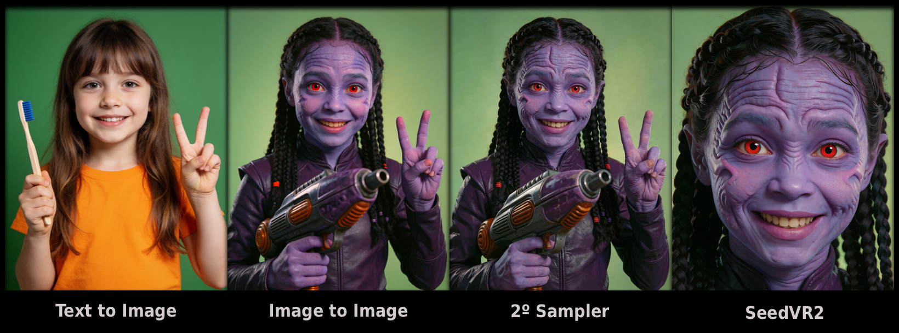

Although I've categorized it under Flux2 in my Workflows, this is actually a model trained from scratch, using Qwen3-VL as its text encoder and Qwen Image VAE for decoding.

I'm currently using the Turbo version, and I've been really impressed with its quality and speed! It's a surprisingly capable model, delivering great results without requiring too much time for generation.

One of its most interesting features is the ability to interpret JSON-based layouts containing bounding boxes (BBoxes), allowing for more precise control over image composition. It's somewhat similar to what Ideogram 4.0 offers, although both models produce quite different results.

I'm still learning how to get the most out of this model, and there are quite a few things I haven't explored yet, such as ControlNet integration. But one step at a time!

### GGUF Support
If you're planning to use this model in GGUF format, you'll need a specific `custom_node`: a fork of the original `city96/ComfyUI-GGUF project`.

This fork extends the original implementation with additional compatibility, since the original project hasn't received updates in a while. I've already switched to this version in my Workflows, so make sure you have it installed if you're using GGUF models.

### Available Workflows
Here are the Workflows I've created so far:
| Workflow | Description |
|---|---|
| TXT2IMG | A simple Text-to-Image Workflow using the Krea2 Turbo. |
| TXT2IMG+ | An extended version of TXT2IMG, integrating the RES4LYF Sampler for additional sampling options and more control over image generation. |
| IMG2IMG | An Image-to-Image Workflow that allows you to generate new images based on an existing one. |
| SeedVR2 Upscaler | Uses a second KSampler to enhance details before optionally upscaling the image through the SeedVR2 group. |
| Tile & SeedVR2 Upscaler | An impressive way to enhance images by dividing them into tiles, upscaling each one individually, and then combining them into a single, higher-quality image. |

Folder to the Workflows [Flux2](./Workflows/FLUX-2/).
Folder with example [Images](./Images/FLUX-2/).

## Flux2 Klein
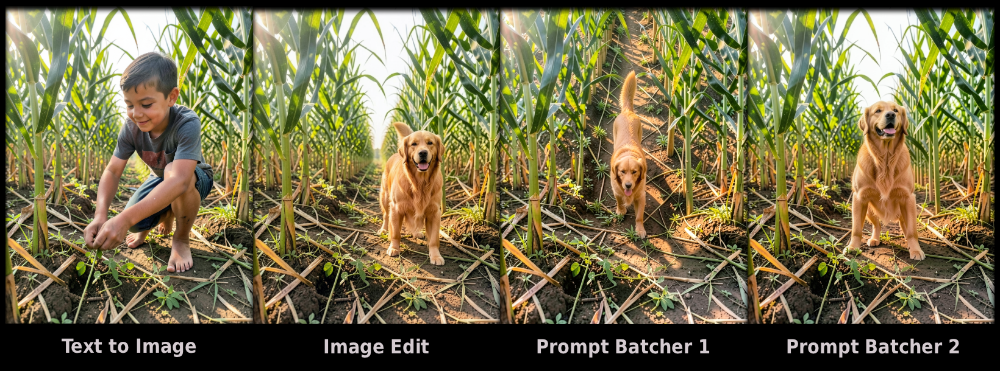

This is probably the model that has impressed me the most so far! It's incredibly easy to use, delivers spectacular image quality, and offers excellent generation speed.

One of its most impressive features is the ability to perform context-aware image editing, allowing you to make changes through natural language instructions, much like Gemini and ChatGPT. I believe this represents a major step forward for local image generation, especially considering how accessible and versatile this model is.

Unfortunately, my current hardware doesn't allow me to run the full FLUX.2 models, so I'm sticking with Klein for now. Hopefully, I'll be able to upgrade my machine someday and create Workflows for the larger models as well. Although, considering the current hardware market, that might take a while!

### Model Compatibility
All the Workflows below are compatible with both the 4B and 9B versions of FLUX.2 Klein. Just make sure to use the corresponding CLIP/text encoder when switching between them.

### Available Workflows
Here are the Workflows I've created so far:
| Workflow | Description |
|---|---|
| TXT2IMG | A simple Text-to-Image Workflow using a `custom_node` which allows for generating different images using prompts for each line in a single node. |
| IMG2IMG | An Image-to-Image Workflow that allows you to generate new images based on an existing one. |
| SeedVR2 Upscaler | Uses a second KSampler to enhance details before optionally upscaling the image through the SeedVR2 group. |
| Tile & SeedVR2 Upscaler | An impressive way to enhance images by dividing them into tiles, upscaling each one individually, and then combining them into a single, higher-quality image. |
| Edit | Takes image editing a step further than traditional IMG2IMG, allowing for context-aware modifications using natural language instructions and additional reference images. I've also included a Simple Prompt Batcher, so you can apply multiple changes using different prompts without having to process them one by one. |
| Edit in Bulk | Designed to make repetitive image editing tasks much easier. For example, if you need to remove watermarks or unwanted elements from multiple images, this Workflow helps automate the process instead of editing each image individually. |

Folder to the Workflows [Flux2](./Workflows/FLUX-2/).
Folder with example [Images](./Images/FLUX-2/).

## Flux1
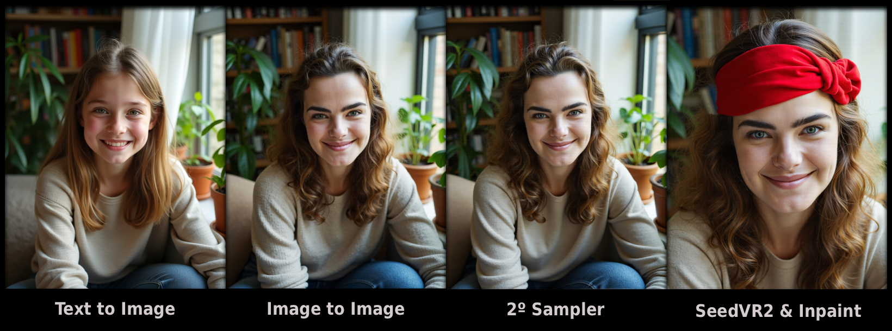

FLUX used to be my favorite model for photorealism and LoRA training, although I still find myself coming back to it from time to time!

Besides its impressive realism, it's an incredibly versatile model, capable of editing existing images, expanding photos, and contextually filling in new areas with impressive consistency. It's a pretty complete model, even if it's on the heavier side.

I've also been using FLUX Fill, especially for outpainting, and it's been a great addition to my Workflows.

### Text Encoders
FLUX uses two text encoders: CLIP-L and T5. From my experience, I've found that using short, descriptive tags in CLIP-L and longer, more detailed prompts in T5 works particularly well.

### Available Workflows
Here are the Workflows I've created so far:
| Workflow | Description |
|---|---|
| TXT2IMG | A simple Text-to-Image Workflow with optional Detail Daemon integration to enhance image details during generation. |
| IMG2IMG | An Image-to-Image Workflow with ControlNet integration, useful when you want to generate an image that closely resembles the original. |
| Face Detailer | Designed to enhance facial details without modifying the rest of the image. Particularly useful for people photographed from a distance, where faces often lose quality during generation. |
| Inpaint & Outpaint | Designed to be as simple as possible. Just load an image, choose whether to create a mask manually or let Florence2 handle it, and select between inpainting and outpainting. Uses FLUX Fill for the editing process. |
| Ultimate SD Upscaler | A more traditional tile-based upscaling approach, offering additional control over the generation and refinement process. In some situations, I still find it to be the best option, although your mileage may vary! |
| SeedVR2 Upscaler | Uses a second KSampler to enhance details before optionally upscaling the image through the SeedVR2 group. |
| Tile & SeedVR2 Upscaler | An impressive way to enhance images by dividing them into tiles, upscaling each one individually, and then combining them into a single, higher-quality image.
| XY Plot | Created to compare different settings, such as a range of LoRA strength values. You can easily adapt it to test and visualize other parameters as well. |

Folder to the Workflows [Flux](./Workflows/FLUX/).
Folder with example [Images](./Images/FLUX/).

## Ideogram 4.0
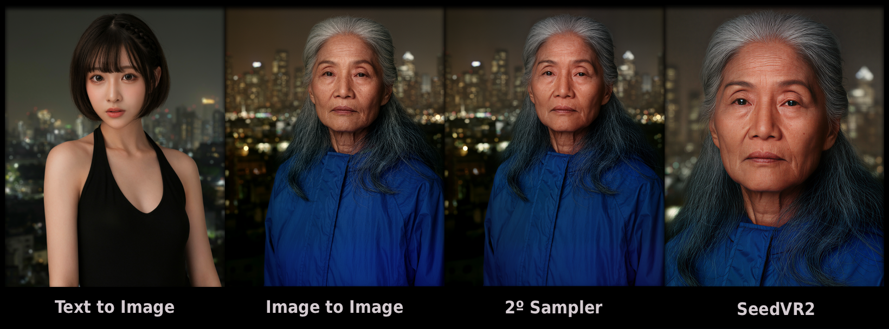

Ideogram 4.0 is another model with a promising future! Although it's quite slow and a bit more complicated when it comes to prompting, its image quality is excellent, and it offers some really impressive capabilities.

One of its biggest advantages is the ability to interpret JSON-based layouts containing bounding boxes (BBoxes), allowing you to specify exactly where different objects should appear within a scene. This gives you much greater control over image composition, which is one of the things I find most interesting about this model.

Since Ideogram 4.0 relies on structured JSON prompts, I recommend using my QwenVL Workflow along with the guided instructions provided in the [Ideogram4](./Ideogram4/) file. This makes it much easier to generate properly formatted prompts using an LLM.

I'm still exploring the model and figuring out the best ways to work with it, but despite its slower generation speed, the results have been quite impressive!

### Prompt builder & model configuration
I've separated the Prompt Builder into its own Workflow using KJNodes, making it more flexible and reusable. If you're working with other models that use Qwen-based text encoders, such as FLUX.2 Klein, you can also adapt this Workflow to generate structured JSON prompts for them.

As for the model configuration, I've chosen to use only the standard Ideogram model, without combining it with the unconditional version, since I've been getting better results this way.

I'm also not using GGUF for the diffusion model itself, only for the text encoder (CLIP), as GGUF support for the main model isn't available in my current ComfyUI setup.

### Available Workflows
Here are the Workflows I've created so far:
| Workflow | Description |
|---|---|
| TXT2IMG | A simple Text-to-Image Workflow using Ideogram 4.0, with support for structured JSON prompts and BBox-based image composition. |
| IMG2IMG | An Image-to-Image Workflow that allows you to generate new images based on an existing one. |
| Prompt Builder | A dedicated Workflow for generating structured JSON prompts from an image or text description. You can also create and configure BBoxes directly within it, making it easier to control the composition of your images. |
| SeedVR2 Upscaler | Uses a second KSampler to enhance details before optionally upscaling the image through the SeedVR2 group. |

Folder to the Workflows [Ideogram](./Workflows/IDEOGRAM-4/).
Folder with example [Images](./Images/IDEOGRAM-4/).

## SD-SDXL
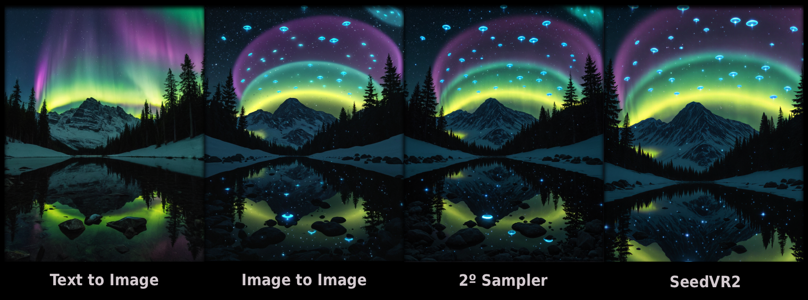

Still one of my favorite models for generating both illustrative and semi-photorealistic content! Despite having been around for quite some time, it remains incredibly versatile and capable of producing impressive results.

One of its biggest strengths is its massive ecosystem of Checkpoints, LoRAs, and other community resources. Whether you're looking for realistic photography, anime, digital illustrations, or something entirely different, there's probably a model or LoRA out there that fits exactly what you need.

And honestly, that's what makes this model so special. Even with newer and more advanced alternatives becoming available, it continues to be incredibly useful, especially when you want more control over the final result.

### LoRAs & Checkpoints
With such a huge variety of Checkpoints available, you can achieve completely different results without having to change your entire Workflow. I personally enjoy experimenting with different combinations of Checkpoints and LoRAs to see what works best for a particular style or subject.

I've also included a dedicated Two LoRA Hooks Workflow, which makes it easier to combine two different LoRAs within the same image while helping reduce unwanted interference between them. This is particularly useful when working with multiple characters or combining different artistic styles.

Just keep in mind that LoRA compatibility and strength settings can make a big difference, especially when mixing different Checkpoints and styles!

### Available Workflows
Here are the Workflows I've created so far:
| Workflow | Description |
|---|---|
| TXT2IMG | A simple Text-to-Image Workflow, allowing you to experiment with different Checkpoints, LoRAs, and styles. |
| IMG2IMG | An Image-to-Image Workflow with ControlNet integration, useful when you want to generate an image that closely resembles the original. |
| Inpaint & Outpaint | Designed to be as simple as possible. Just load an image, choose whether to create a mask manually or let Florence2 handle it, and select between inpainting and outpainting. |
| Two LoRA Hooks | Designed to combine two different LoRAs within a single image while minimizing unwanted artifacts, duplicated elements, and interference. Useful for combining two characters, artistic styles, or pose styles with greater control. |
| SeedVR2 Upscaler | Uses a second KSampler to enhance details before optionally upscaling the image through the SeedVR2 group. |
| Tile & SeedVR2 Upscaler | An impressive way to enhance images by dividing them into tiles, upscaling each one individually, and then combining them into a single, higher-quality image. |
| XY Plot | Created to compare different settings, such as a range of LoRA strength values. You can easily adapt it to test and visualize other parameters as well. |

Folder to the Workflows [SD-SDXL](./Workflows/SD-SDXL/).
Folder with example [Images](./Images/SD-SDXL/).

## Anima
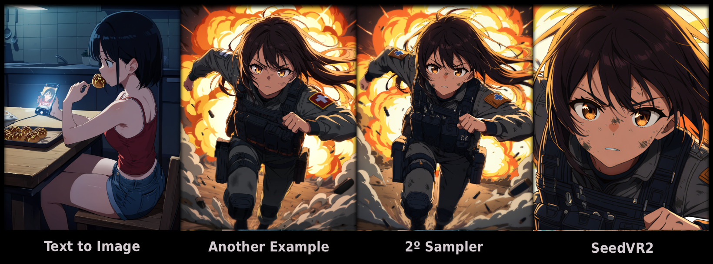

Anima is an extraordinary model being developed by the folks at CircleStone Labs, in collaboration with Comfy Org. Currently in its 1.0 release, it already offers different variants, including Base, Aesthetic, and Turbo (the latter being my personal recommendation!).

I see a lot of potential in this model, especially when it comes to overall image quality, prompt adherence, and consistency in generating anime-style images. Although anime is clearly its main focus, I've also seen some surprisingly good results with more realistic styles.

I'm still exploring its capabilities and experimenting with different approaches to get the most out of it. One thing I'm particularly interested in is integrating ControlNet into my Image-to-Image Workflow. I haven't quite figured it out yet, but I'm getting close!

### Model variants & prompting
For now, I recommend using the Turbo version, as it offers a great balance between generation speed and image quality.

Anima also has its own prompting characteristics, so getting familiar with its recommended tags and prompt structure can make a noticeable difference in the results.

I strongly recommend checking out the official [Anima page on Hugging Face](https://huggingface.co/circlestone-labs/Anima) for more information about the available variants, prompting techniques, and supported tags.

### Available Workflows
Here are the Workflows I've created so far:
| Workflow | Description |
|---|---|
| TXT2IMG | A simple Text-to-Image Workflow designed for generating anime-style illustrations and experimenting with different prompts and styles. |
| IMG2IMG | An Image-to-Image Workflow that allows you to generate new images based on an existing one. ControlNet integration is something I'm still working on! |
| SeedVR2 Upscaler | Uses a second KSampler to enhance details before optionally upscaling the image through the SeedVR2 group. |
| Tile & SeedVR2 Upscaler | An impressive way to enhance images by dividing them into tiles, upscaling each one individually, and then combining them into a single, higher-quality image. |

Folder to the Workflows [Anima](./Workflows/ANIMA/).
Folder with example [Images](./Images/ANIMA/).

## Captions
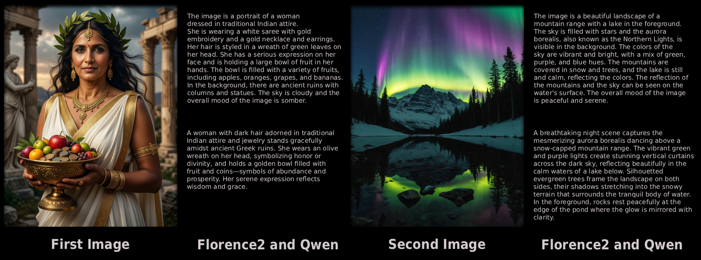

I've always used captions when training my LoRAs, and over time, I've experimented with several models to find the best balance between accuracy, consistency, and detail.

Captions are especially useful for preparing training datasets, but they can also serve another purpose: analyzing an existing image and generating a descriptive prompt that can be used for image generation.

The Workflows I've created are quite similar in structure. They allow you to caption a single image or process multiple images in batches, automatically saving the results to a folder. The main difference between them is the model used for captioning and how each one interprets the image.

### LoRA training & caption editing
For LoRA training, I personally recommend using Florence2 as a starting point. It's fast, consistent, and generally produces reliable captions, even if it sometimes misses smaller details.

After generating your captions, I strongly recommend reviewing and refining them manually, especially when preparing a dataset for a specific character, object, or style. Even the best captioning models can overlook important details or include information you don't necessarily want the LoRA to learn.

To make this process easier, I've also developed my own [Caption Editor](https://github.com/VictorDmAlves/caption-editor/), which allows you to review and modify captions while viewing their corresponding images. It's particularly useful when working with larger datasets, where editing individual text files can become quite tedious!

### Available Workflows
Here are the Workflows I've created so far:
| Workflow | Description |
|---|---|
| Florence2 | My personal favorite for captioning! It's fast, consistent, and generally reliable, although it can sometimes produce descriptions that are a little too simple or lacking in detail. Still, it's my preferred choice for preparing LoRA training datasets. |
| QwenVL | One of the most capable models for generating detailed captions, with support for custom instructions, much like ChatGPT. However, it can also hallucinate details and produce inconsistent results. I've included an example instruction in the Workflow to help you get started. |
| WD 1.4 Tagger | A great option for generating Danbooru-style tags, especially useful for anime illustrations and datasets that benefit from tag-based descriptions rather than natural language captions. |

Folder to the Workflows [Captions](./Workflows/CAPTIONS/).
Folder with example [Images and Captions](./Images/CAPTIONS/).